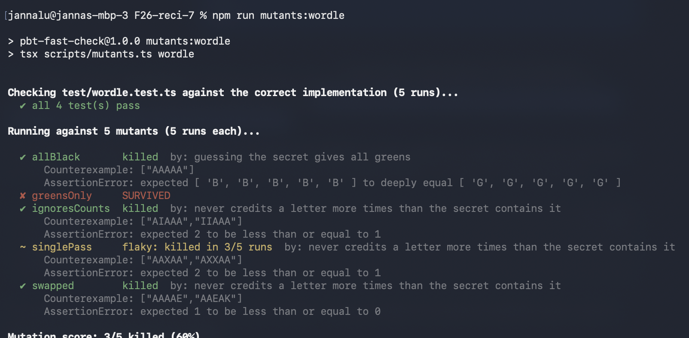
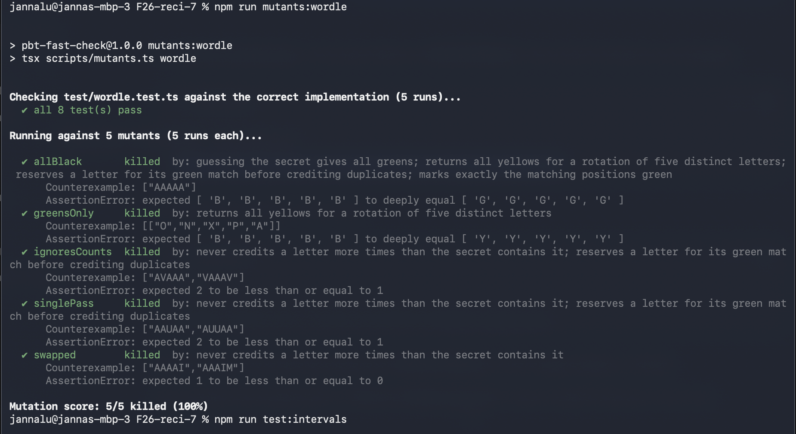

# Reflection

**Name / Andrew ID:** Janna Lu / jannaanl

**Recitation group members (Task 2):** N/A

---

### 1. Valid but weak

The Wordle property "returns exactly five colors" passes on the correct implementation but kills no mutants. It is still a valid property because the wordle requires one color for each of the five letters guessed. A property should still check a requirement even if a mutant doesn't violate it. 

It would catch an off by one bug where the result array has 6 letters instead of 5, causing the function to return an extra color. 

### 2. A generator problem, not a property problem

Describe a mutant, from either task, that survived or was flaky because of
your **generator** rather than your property. What did the generator fail to
produce? How did you fix it? Paste the runner output from before and after.

The mutant `singlePass` was flaky because my generater used all 26 letters, so it did not generate duplicate-letter cases that exposed the bug. My property already checked that a letter could not be credited more times than it appeared in the secret.

I fixed this by adding a targeted generator that chooses 2 distinct letters, `a` and `b`, and constructs the secret as `aaaab` and the guess as `aaabb`. The expected output is `GGGBG`, because the secret’s only b must be reserved for the green match.

#### Runner output before fixing the generator

#### Runner output after fixing the generator

### 3. Reading a counterexample

✔ mergesIntegerNeighbors  killed  by: preserves exactly the same points; preserves already separated intervals; keeps intervals with a one-unit gap separate; preserves point coverage; preserves already sorted and separated intervals
      Counterexample: [[[13,13],[2,12]]]

The specification requires that the two lists are preserved if there is a gap between the two lists. So [2,12] and [13,13] must remain separate because there is a gap between 12 and 13. The mutant incorrectly merges them into [2,13], covering points such as 12.5 that neither input interval covers.

### 4. Your project

One function in my team's project that would benefit from property-based testing is our `/group` command which organizes files into a Repository Learning Map and prioritizes groups containing session-referenced files. 

1.  Invariant: The map must contain at most 30 groups, and each group must contain at most 20 subgroups, regardless of the repository’s size or structure.

2. Conditional: If some groups contain session-referenced files and others do not, the referenced groups should appear before the unreferenced groups.

The generator would construct repository file trees into unique, valid, relative paths and varied directory depths and file extensions. It would include empty repositories and generate distinct directories to test the group and subgroup limits. For the conditional property, it would select session references from existing files and ensure that both referenced and unreferenced groups exist. A naive generator might create references to nonexistent files or only small repositories. 